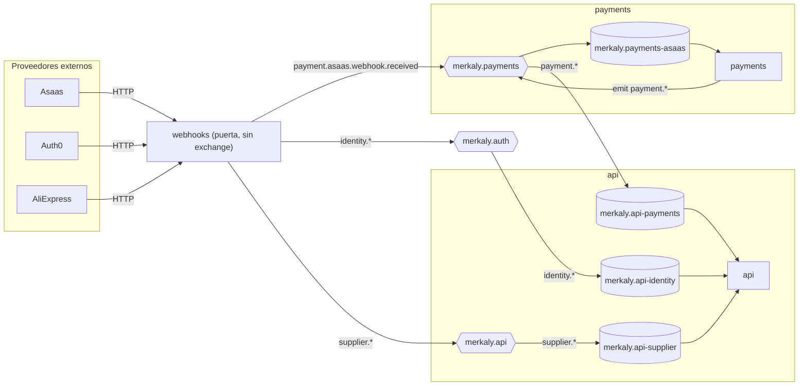

Merkaly separa tres responsabilidades: entrar (webhooks), hablar con el proveedor de pagos (payments) y decidir (api). Cada servicio hace una sola cosa, y los mensajes entre ellos viajan por RabbitMQ.

| Servicio | Qué hace | Qué no hace |
| --- | --- | --- |
| [webhooks](/glosario/webhooks) | Recibe a los proveedores por HTTP, valida la firma y entrega el mensaje en el exchange del dueño. | No tiene exchange propio, base de datos ni lógica de negocio. |
| [payments](/glosario/payments) | Es el único que habla con el proveedor de pagos (Asaas hoy). Traduce avisos y responde invokes. | No guarda estado: el api le manda en cada pedido lo que necesita. |
| [api](/glosario/api) | Guarda todos los registros y aplica las reglas de negocio. Atiende a los frontends por HTTP. | Nunca ve el nombre, el estado ni las credenciales del proveedor. |
| [signals](/glosario/signals) | Envía notificaciones (email hoy). | Nadie le publica comandos todavía. |

Los frontends ([store / admin](/glosario/frontends)) siempre le hablan al api por HTTP: nunca a webhooks, a payments ni al broker.

## El mapa

Hexágonos: exchanges. Cilindros: colas. Para ver un mensaje recorriendo este mapa, abre [los flujos](/flujos).
