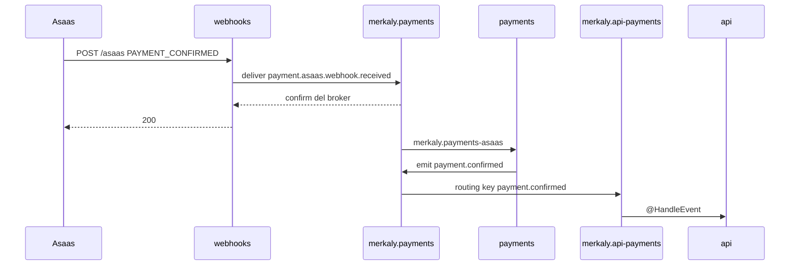

## Las reglas

::u-page-grid
  :::u-page-card
  ---
  title: webhooks es la puerta
  description: Los proveedores no hablan con Rabbit. webhooks valida, deja lo mínimo y entrega en el exchange del dueño con deliver. No tiene exchange propio y solo vuelve a intervenir para responder un invoke.
  icon: i-lucide-door-open
  to: /glosario/webhooks
  ---
  :::

  :::u-page-card
  ---
  title: Un exchange por dueño de dominio
  description: merkaly.<servicio>, de tipo topic. Asaas entrega en merkaly.payments, Auth0 en merkaly.auth y AliExpress en merkaly.api. La routing key es el tipo del mensaje.
  icon: i-lucide-hexagon
  to: /glosario/merkaly-payments
  ---
  :::

  :::u-page-card
  ---
  title: Una cola por trabajo
  description: merkaly.<servicio>-<trabajo>, del que consume, suscrita a tipos exactos (sin comodines), con sus auxiliares .retry y .dlq. Los invokes van a merkaly.<servicio>-invokes.
  icon: i-lucide-database
  to: /glosario/merkaly-api-payments
  ---
  :::

  :::u-page-card
  ---
  title: Nada se pierde en silencio
  description: Todo publish va con confirm y mandatory. Si nadie escucha ese tipo, falla, webhooks responde 5xx y el proveedor reintenta.
  icon: i-lucide-shield-check
  to: /glosario/mandatory
  ---
  :::
::

- **Ruteo explícito**: el mapa proveedor a dueño vive en un solo archivo de webhooks (`src/app.routes.ts`). Cambiar de dueño es cambiar una línea; no hay bindings entre exchanges que escondan el ruteo en el broker.
- **Nombres**: sin prefijo de transporte ni de servicio. Eventos en pasado (`payment.confirmed`), comandos e invokes con verbo (`email.send`, `payment.withdrawal.authorize`).
- **Ligar desde otro dominio**: una cola puede escuchar el exchange de otro dueño (`from`). El api liga `merkaly.api-payments` a `merkaly.payments` con `from: "payments"`.
- **Orden no garantizado**: los consumidores releen el estado real (por ejemplo, el api relee el cobro con [payment.charge.read](/glosario/payment-charge-read)) y deduplican por el id del mensaje.

## Clases de mensaje

| Clase | Quién publica | En qué exchange | Respuesta |
| --- | --- | --- | --- |
| Evento | quien vivió el hecho (`emit`) | el propio | no |
| Evento entregado | la puerta (`deliver`) | el del dueño | no |
| Comando | quien pide algo (`command`) | el del destino | no |
| Invoke | quien pregunta (`invoke`) | el del que responde | sí, en segundos, por `amq.rabbitmq.reply-to` |

## Exchanges, colas y mensajes

| Exchange | Cola | Consume | Mensajes | Quién los pone |
| --- | --- | --- | --- | --- |
| `merkaly.payments` | `merkaly.payments-asaas` | payments | `payment.asaas.webhook.received` | webhooks |
| `merkaly.payments` | `merkaly.payments-invokes` | payments | `payment.charge.*`, `payment.movement.check` y el resto del catálogo | api y webhooks |
| `merkaly.payments` | `merkaly.api-payments` | api | `payment.confirmed`, `payment.received`, `payment.refunded`, `payment.account.*`, `payment.transfer.*` | payments (traducidos) |
| `merkaly.auth` | `merkaly.api-identity` | api | `identity.signup.requested`, `identity.organization.*` | webhooks (Auth0) |
| `merkaly.api` | `merkaly.api-identity` | api | `account.user.linked` | el propio api |
| `merkaly.api` | `merkaly.api-supplier` | api | `supplier.order.status_changed`, `supplier.product.updated` | webhooks (AliExpress) |
| `merkaly.api` | `merkaly.api-invokes` | api | `payment.withdrawal.authorize`, `payment.refund.authorize` | payments |
| `merkaly.signals` | `merkaly.signals-emails` | signals | `email.send` | nadie todavía |

Los eventos internos del api (por ejemplo `order.sale.payment.changed`) siguen en memoria, no pasan por Rabbit.

## Ejemplo: un pago confirmado

El mismo recorrido, animado:

::content-flow{flow="pago-confirmado-asaas"}
::
