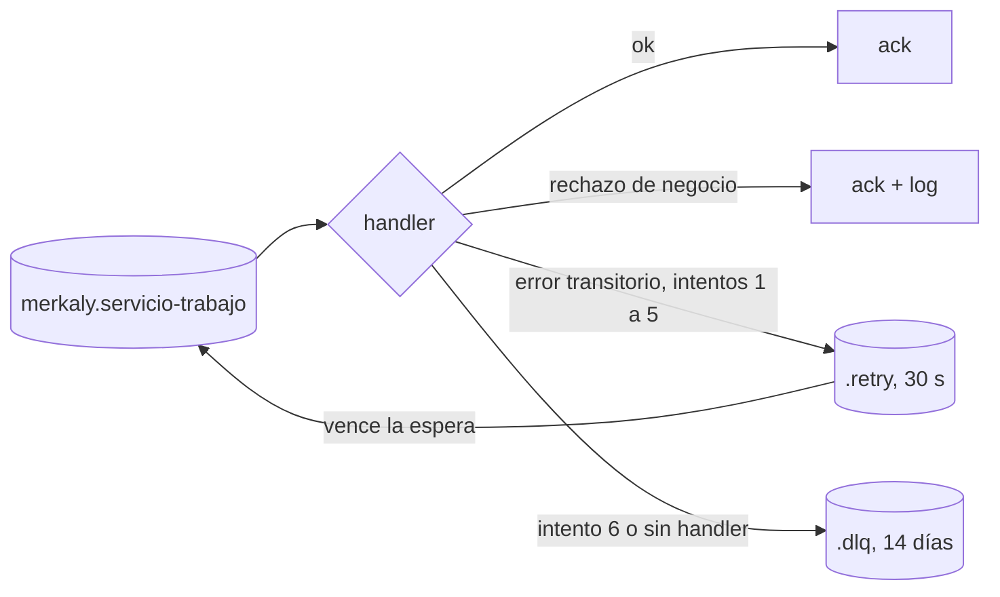

| Resultado del handler | Qué pasa |
| --- | --- |
| Éxito | `ack`. |
| Rechazo de negocio (venta inexistente, monto distinto) | `ack` y un aviso en el log: reintentar no lo arregla. |
| Error transitorio (Mongo, red, proveedor caído) | Copia a [.retry](/glosario/retry-queue), espera 30 s y vuelve a la cola, hasta 5 veces. El original se confirma solo cuando el broker confirmó la copia. |
| Malformado, sin handler o versión desconocida | Directo a la [.dlq](/glosario/dead-letter-queue). |

- Cada mensaje que entra a una `.dlq` deja una línea `ERROR [DLQ]` en el log del servicio. Cualquier `.dlq` con mensajes merece revisión.
- Reprocesar: corregir la causa y mover los mensajes de `<cola>.dlq` a `<cola>`; los ya procesados se saltan por el id.
- Mira el recorrido animado en [El handler falla: reintentos](/flujos/reintentos).

## Invokes

- Quien pregunta espera 5 s por defecto; las operaciones lentas pasan su propio timeout (40 s para crear un cobro Pix).
- Un invoke perdido nunca se reintenta solo: toda escritura tiene que poder repetirse sin efecto doble.
- La cola de invokes descarta lo que nadie atendió en 30 s. Quien pregunta decide qué hacer si no hay respuesta (webhooks responde `REFUSED` a Asaas).

## Políticas del broker

Los límites de las colas ya creadas se ajustan con [operator policies](/glosario/operator-policy), que el broker aplica encima de los argumentos de cada cola.

| Policy | Aplica a | Efecto |
| --- | --- | --- |
| `merkaly-work` | colas de trabajo (no `.retry`, `.dlq` ni `-invokes`) | Máximo 10.000 mensajes. Llena, rechaza lo nuevo (el publish falla y el proveedor reintenta) y deja una copia en la `.dlq`. |
| `merkaly-dlq` | `.dlq` | Guarda cada mensaje 14 días. |
