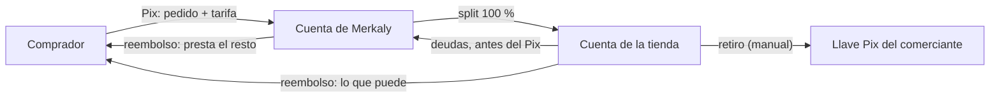

## Qué es

Cómo la tienda recibe el dinero de sus ventas, lo devuelve y lo retira.

- Merkaly tiene la [cuenta principal](/glosario/merkaly-main-account) en el proveedor de pagos ([Asaas](/glosario/asaas) hoy). Cada tienda tiene su [cuenta de pago](/glosario/payment-account), que solo sirve para recibir.
- Cada [cobro](/glosario/payment-charge) se crea en la cuenta de Merkaly con un [split](/glosario/split) del 100 % a la tienda. Merkaly no cobra comisión.
- El comprador paga con Pix (hoy el único método) y paga la [tarifa Pix](/glosario/pix-fee) encima del pedido.
- El comerciante pasa su saldo a su llave Pix con un [retiro](/glosario/withdrawal), siempre manual.
- El [api](/glosario/api) guarda todos los registros y las reglas. Solo [payments](/glosario/payments) habla con el proveedor, y no guarda estado.
- El estado del pago es consecuencia del estado de la venta: lo mueven los flujos de la venta, nunca una persona.

## El camino del dinero

## Quién paga qué

| Qué | Quién lo paga |
| --- | --- |
| El pedido (ítems, flete, impuestos) | el comprador, a la tienda |
| La tarifa Pix | el comprador, encima del pedido |
| Comisión de Merkaly | nadie: no hay |
| Tarifa por retiro del proveedor | la tienda, si el proveedor la cobra |
| La tarifa de un reembolso y lo que falte en la cuenta de la tienda | Merkaly lo presta; la tienda lo devuelve en su próximo retiro |

## Cuánto puede retirar la tienda

| Pieza | Qué es |
| --- | --- |
| liberado | El neto de cada venta pagada en línea (pagado menos sus reembolsos), 7 días después de su entrega. Antes, nada. |
| retenido | Lo pagado que no se liberó: ventas sin entregar, en los 7 días, o en disputa. |
| retirado | Los retiros hechos o en curso, más las deudas ya cobradas. |
| deudas | Las deudas abiertas con Merkaly. |
| **retirable** | `min(liberado - retirado, saldo de la cuenta) - deudas`, nunca menos de 0. |

## Aprobación de la cuenta

El proveedor aprueba cada cuenta de pago: datos comerciales, documentos, datos bancarios y la cuenta en general. Ver [Cuenta de pago de la tienda](/ciclos/payment-account).

| Modelo | Cómo manda los documentos el comerciante |
| --- | --- |
| BaaS (marca blanca) | Nunca ve al proveedor: el admin muestra los documentos y un link del proveedor para identidad y selfie. Lo habilita el gerente de cuenta de Asaas y pide sus textos de marca en cada punto de contacto. |
| Sin BaaS (hoy, por defecto) | El proveedor le manda un email de activación; pone una contraseña y manda los documentos en la interfaz del proveedor. |

En producción, la primera subcuenta abre un período de evaluación regulatoria: hasta 10 subcuentas, R$ 2.000,00 en cobros por subcuenta, 60 días, hasta que Asaas aprueba la operación.

## Entidades

Toca una entidad para ver sus campos clave y con qué se relaciona. Las punteadas son de otro dominio.

::content-entity-map{domain="pagos"}
::

## Ciclos de vida

::content-lifecycle-list{domain="pagos"}
::

## Flujos

::content-flow-list{domain="pagos"}
::

El reembolso de una venta pagada:

::content-flow{flow="reembolso-pago"}
::

## Decisiones

- [payments no guarda estado](/pagos/decisiones/payments-sin-estado)
- [Un solo estado del cobro](/pagos/decisiones/un-solo-estado-del-cobro)
- [Un mensaje por proveedor de pagos](/pagos/decisiones/un-mensaje-por-proveedor)
- [Cobrar en la cuenta de Merkaly con split del 100 %](/pagos/decisiones/cobro-en-cuenta-merkaly)
- [Retiros solo manuales](/pagos/decisiones/retiros-manuales)
- [Merkaly presta lo que falta de un reembolso](/pagos/decisiones/merkaly-presta-reembolsos) (reemplazada)
- [El split manda a la tienda solo su lucro](/pagos/decisiones/split-solo-el-lucro)
- [Quién absorbe la tarifa del Pix en un reembolso](/pagos/decisiones/tarifa-en-reembolsos)

## Por confirmar

- El tratamiento fiscal de que Merkaly reciba y pase el 100 %.
- Qué pasa con un contracargo o un reembolso cuando la cuenta de la tienda ya no tiene el dinero.

## En el código

| Dónde | Qué hay |
| --- | --- |
| [api.merkaly.io `src/domain/integration/payment`](https://github.com/merkaly-io/api.merkaly.io/tree/master/src/domain/integration/payment) | Cuenta de pago, cobros, retiros y el puente con payments |
| [api.merkaly.io `src/domain/finance`](https://github.com/merkaly-io/api.merkaly.io/tree/master/src/domain/finance) | Registros: pagos, reembolsos, retiros, contracargos y deudas; saldo retirable |
| [api.merkaly.io `src/application/dashboard/finance`](https://github.com/merkaly-io/api.merkaly.io/tree/master/src/application/dashboard/finance) | Reportes del dashboard: pagos de todas las tiendas y caja de Merkaly |
| [payments.merkaly.io `docs/contract.md`](https://github.com/merkaly-io/payments.merkaly.io/blob/master/docs/contract.md) | Contrato entre api, webhooks y payments |
| [api.merkaly.io `docs/runbooks/asaas-account-setup.md`](https://github.com/merkaly-io/api.merkaly.io/blob/master/docs/runbooks/asaas-account-setup.md) | Cómo armar la cuenta principal en Asaas |

## Glosario

::content-glossary{domain="pagos"}
::
