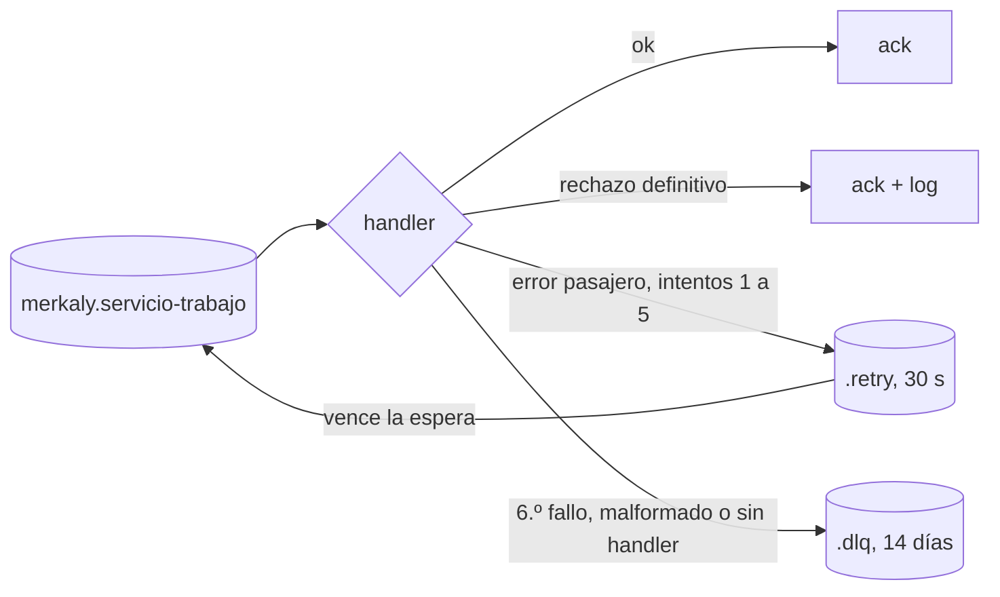

## La idea

Cuando un handler falla, la pregunta es una sola: **¿reintentar lo puede arreglar?**

- Si sí (la base no respondió, el proveedor está caído, AliExpress pidió esperar), el mensaje espera 30 s y se intenta de nuevo, hasta 5 veces.
- Si no (la venta no existe, el monto no coincide, el CPF no corresponde al nombre), reintentar solo repite el error: el mensaje se confirma y queda un aviso en el log o en el registro afectado.
- Lo que no se pudo procesar tras los reintentos no se borra: queda en la [.dlq](/glosario/dead-letter-queue) para revisarlo.

::content-flow{flow="reintentos"}
::

## Pasajero o definitivo

| Resultado del handler | Qué pasa |
| --- | --- |
| Éxito | `ack`. |
| Rechazo definitivo: un 4xx (venta inexistente, cobro ajeno, monto distinto) o `EventRejectedException` | `ack` y un aviso en el log: reintentar no lo arregla. |
| Evento ligado pero sin listener en el servicio | `ack` y aviso `No listener`. |
| Error pasajero: 5xx, Mongo, red, proveedor caído, límite de AliExpress | Copia a [.retry](/glosario/retry-queue), espera 30 s y vuelve a la cola, hasta 5 veces. El original se confirma solo cuando el broker confirmó la copia. |
| 6.º fallo | Directo a la `.dlq`. |
| Malformado, versión desconocida o sin handler para esa routing key | Directo a la `.dlq`, sin reintentos. |

En el api y en payments la regla está en un solo lugar (el `BrokerController` de cada uno): un error con estado HTTP menor a 500 es definitivo; cualquier otra cosa es pasajera. Algunos flujos deciden más fino; la compra automática, por ejemplo, anota en la compra el motivo de un rechazo de AliExpress y solo relanza las fallas pasajeras (ver [Mensajes de la compra automática](/flujos/mensajes-compra-automatica)).

## Cómo funciona la .retry

- Cada cola de trabajo tiene una `<cola>.retry` **sin consumidores**. Su `x-message-ttl` (30 s) hace esperar el mensaje y, al vencer, el broker lo devuelve a la cola original.
- El número de intento viaja en el header `x-merkaly-retries`.
- La espera es fija: 30 s × 5 en todas las colas (son los valores por defecto del paquete y ningún servicio los cambia). Una espera creciente (30 s, 2 min, 10 min) necesitaría una `.retry` por nivel en `@merkaly/nest`; hoy no existe.
- Un reintento vuelve a correr el handler completo, desde el principio. Por eso cada handler tiene que poder correr dos veces sin efecto doble.

## La .dlq

- Cada mensaje que entra a una `.dlq` deja una línea `ERROR [DLQ]` en el log del servicio. Cualquier `.dlq` con mensajes merece revisión.
- La operator policy `merkaly-dlq` guarda cada mensaje 14 días.
- Reprocesar: corregir la causa y mover los mensajes de `<cola>.dlq` a `<cola>`. Los handlers son idempotentes, así que un mensaje ya aplicado no cambia nada.
- Un mensaje que nadie consumió en 7 días también termina en la `.dlq` (TTL de la cola principal).

## Invokes

- Los [invokes](/glosario/invoke) no tienen `.retry` ni `.dlq`: son preguntas con tiempo límite.
- Quien pregunta espera 5 s por defecto; cada llamada puede pasar su propio timeout. El api espera 25 s a payments (40 s para crear un cobro Pix o una cuenta) y webhooks espera 3 s la respuesta de `payment.movement.check`.
- Un invoke perdido nunca se reintenta solo: si no hay respuesta, falla y quien preguntó decide qué hacer (webhooks responde `REFUSED` a Asaas).
- La cola de invokes descarta lo que nadie atendió en 30 s, y el que responde descarta lo que ya venció (quien preguntó ya se rindió).
- Si el broker no está conectado, el publish falla en el acto: nunca se guarda en memoria para mandarlo después.

Mira el recorrido en [Un invoke sin respuesta](/flujos/invoke-sin-respuesta).

## Políticas del broker

Los límites de las colas ya creadas se ajustan con [operator policies](/glosario/operator-policy), que el broker aplica encima de los argumentos de cada cola.

| Policy | Aplica a | Efecto |
| --- | --- | --- |
| `merkaly-work` | colas de trabajo (no `.retry`, `.dlq` ni `-invokes`) | Máximo 10.000 mensajes. Llena, rechaza lo nuevo (el publish falla y el proveedor reintenta) y deja una copia en la `.dlq`. |
| `merkaly-dlq` | `.dlq` | Guarda cada mensaje 14 días. |
